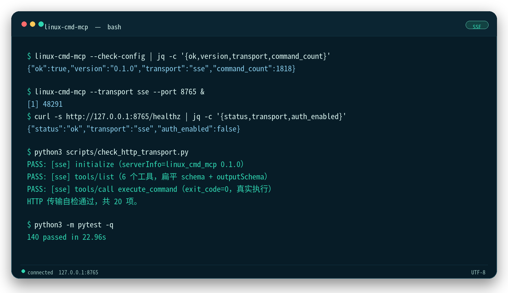

<p align="center">
  
</p>

<h1 align="center">linux-cmd-mcp</h1>

<p align="center">
  
  
  
  
  
</p>

<p align="center">
  
</p>

把 Linux 命令的发现、检查、策略校验与执行封装成 6 个 MCP 工具。模型不必记命令路径，也不用拼接 shell 字符串，按 `command + args` 数组调用即可；默认走 SSE，兼容 Streamable HTTP 与 stdio。

## 核心功能

- **6 个工具覆盖完整链路**：`list_commands` 发现命令 → `describe_command` 查看文件与符号链接 → `check_command` 判断能否执行 → `validate_working_directory` 校验 cwd → `execute_command` 执行 → `get_system_info` 读取基础系统信息。
- **三种传输同一套逻辑**：SSE（默认，`/sse` + `/messages/`）、Streamable HTTP（`/mcp`）、stdio（NDJSON）。切换传输不改变工具、策略或错误码。
- **四档策略可收紧**：`unrestricted` / `permissive` / `standard` / `strict`，内置硬拒绝、软拒绝、环境变量黑名单与工作目录白名单；所有拒绝返回 `isError: true` 的结构化 JSON。
- **命令发现不依赖硬编码目录**：扫描进程 `PATH` 后并入标准命令目录，按 realpath 去重，保留同名命令的全部候选与顺序。本机实测 **1818 个命令名 / 1890 条候选路径**。
- **执行前完成全部校验**：解析路径、策略判定、x 位与静态 `execve` 复核、args/env/timeout/输出上限校验；`dry_run` 只返回计划，不启动进程。

## 快速启动

```bash
pip install -e .
```

```bash
linux-cmd-mcp --transport sse --port 8765
```

启动后验证：

```bash
curl -s http://127.0.0.1:8765/healthz
```

预期返回包含 `{"status":"ok","transport":"sse","auth_enabled":false,...}`。客户端接入示例见 [`examples/`](examples/)。

## 工具清单

| 工具 | 作用 | 关键行为 |
|---|---|---|
| `list_commands` | 列出可发现命令 | 支持名称、目录、允许状态筛选与分页；同名多路径全部保留 |
| `describe_command` | 查看命令详情 | 路径、类型、所有者、权限、inode、符号链接链、全部候选 |
| `check_command` | 只检查不执行 | 存在性、x 位、shebang/ELF 解析、实际 `execve` 复核 |
| `execute_command` | 执行单个命令 | `command` 与 `args` 分离，`shell=True` 永不使用；支持 `cwd`、`env`、`stdin`、超时、输出上限、`dry_run` |
| `get_system_info` | 读取系统信息 | 内核、发行版、架构、主机名、CPU、内存、Python、当前用户；不含密钥与环境变量 |
| `validate_working_directory` | 校验工作目录 | 存在、目录、可读、可写、可搜索、是否在允许根目录内 |

所有业务错误使用固定错误码，例如 `COMMAND_NOT_FOUND`、`COMMAND_NOT_EXECUTABLE`、`POLICY_DENIED`、`CWD_OUTSIDE_ALLOWED_ROOTS`、`TIMEOUT`、`LIMIT_EXCEEDED`。完整表见 [`docs/POLICY.md`](docs/POLICY.md)。

## 安全模型

- 默认 `unrestricted` 等于“以服务器进程用户身份执行任意可发现命令”，能力对齐 SSH 登录；需要护栏时改 `LCMD_POLICY_MODE=standard` 或 `strict`。
- 绑定非回环地址但没配 `LCMD_AUTH_TOKEN` 时，服务器启动直接失败（退出码 64），不会裸奔。
- 配了令牌后，除 `GET /healthz` 外所有请求都要 `Authorization: Bearer <token>`；scheme 大小写不敏感。
- 带 `Origin` 的请求只允许回环来源或 `LCMD_ALLOWED_ORIGINS`；带 userinfo 的伪装来源一律 403。
- 远程部署必须在 nginx/caddy 处终止 TLS，令牌在 HTTP 头中是明文。

## 依赖清单

| 文件 | 名称 | 内容 |
|---|---|---|
| [`pyproject.toml`](pyproject.toml) | 项目与构建配置 | setuptools、包元数据、入口点、pytest 配置 |
| [`pyproject.toml`](pyproject.toml) | 运行依赖 | `mcp>=1.20,<2`、`pydantic>=2.7,<3` |
| [`pyproject.toml`](pyproject.toml) | 测试依赖 | `pytest>=8`、`pytest-asyncio>=0.23` |

无 `requirements.txt`；安装、测试、脚本均以 `pyproject.toml` 为唯一依赖来源。

## 文件夹结构

```text
linux-cmd-mcp/
├── assets/                  # Logo 与仓库视觉资产
├── docs/                    # 策略、巡检、稳定性、诊断报告
├── examples/                # 客户端与宿主配置示例
├── scripts/                 # 握手、传输、巡检、E2E、稳定性脚本
├── src/linux_cmd_mcp/       # 服务器实现
│   ├── tools/               # 6 个工具实现与参数守卫
│   ├── config.py            # 环境变量与限额
│   ├── discovery.py         # PATH 扫描与候选排序
│   ├── policy.py            # 四档策略、拒绝名单、环境变量过滤
│   ├── runner.py            # 子进程执行、超时、取消、输出截断
│   ├── http_transport.py    # SSE / Streamable HTTP、鉴权、Origin
│   └── server.py            # 工具注册与 CLI
└── tests/                   # 140 项单元/集成/协议测试
```

## 自检与验收

```bash
python3 -m pytest -q                                  # 140 passed
python3 -m pyflakes src tests scripts examples
python3 scripts/check_handshake.py                    # stdio 握手 12 项
python3 scripts/check_http_transport.py               # SSE / HTTP 20 项
python3 scripts/check_e2e_tools.py --rounds 2         # 29 条真实命令矩阵，245 项
python3 scripts/check_all_commands.py                 # 1818 命令 / 1890 候选，broken=0
python3 scripts/check_stability.py                    # 并发、超时、长跑、优雅退出 22 项
```

本机实测：140 项 pytest 通过；端到端 245 项通过；全机巡检坏候选 0；稳定性 22 项通过，60 秒 559 次调用内存无增长。

## 文档

- [策略、限额与错误码](docs/POLICY.md)
- [全机命令巡检结论](docs/COMMAND_HEALTH.md)
- [稳定性审计](docs/STABILITY_AUDIT.md)
- [全面诊断报告](docs/AUDIT_REPORT.md)

## License

[MIT](LICENSE)
